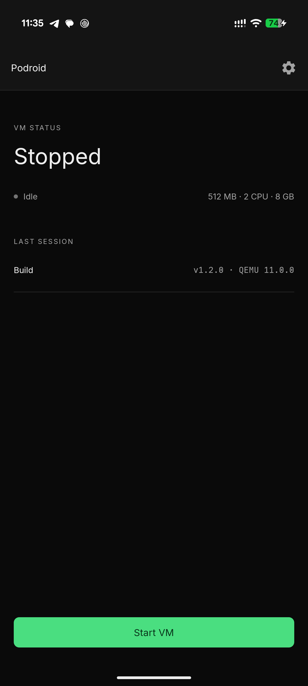
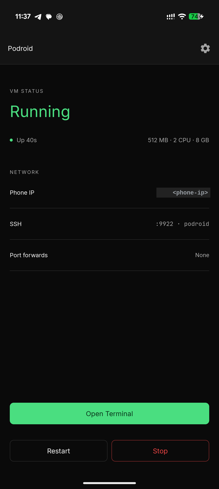
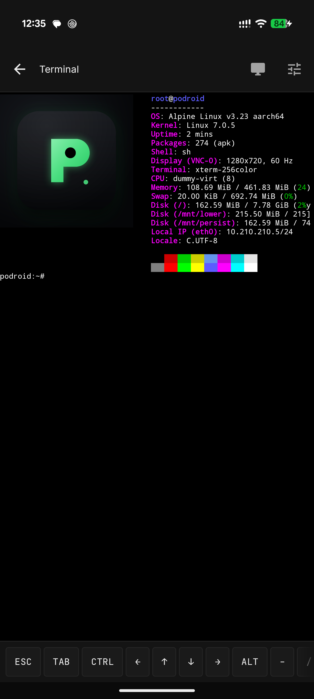
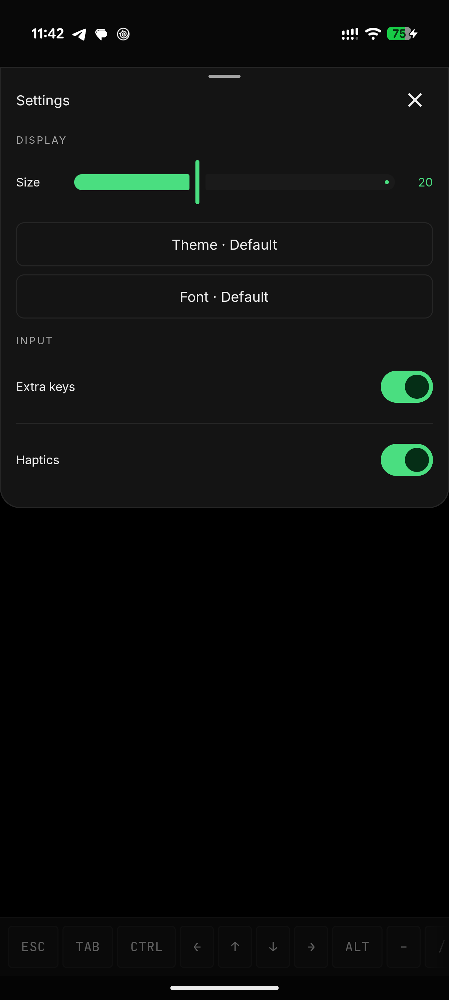

<div align="center">

# ArDroid

**Run Linux containers and a full Linux desktop on your Android phone. No root.**

A real Arch Linux ARM VM with its own kernel - not a chroot or proot trick - so **Podman, Docker and LXC** behave exactly like they do on a server. **box64** comes pre-installed for running x86_64 binaries.

[](https://github.com/Sulaiman507/ArDroid/stargazers)
[](LICENSE)


[**Download APK**](https://github.com/Sulaiman507/ArDroid/actions) · from the latest successful *Build ArDroid APK (cloud)* run

<table>
  <tr>
    <td align="center" width="25%"><br /><sub><b>Home</b></sub></td>
    <td align="center" width="25%"><br /><sub><b>Running</b></sub></td>
    <td align="center" width="25%"><br /><sub><b>Terminal</b></sub></td>
    <td align="center" width="25%"><br /><sub><b>Themes &amp; fonts</b></sub></td>
  </tr>
</table>

</div>

## What you get

- **Arch Linux ARM** - rolling release, `pacman`, `systemd`
- **Podman, Docker and LXC** - pre-installed, ready the moment it boots
- **box64** - run x86_64 Linux binaries on your ARM phone
- **A real VM** - Arch Linux ARM on a prebuilt kernel via QEMU, or hardware-accelerated AVF on supported pKVM devices
- **In-app terminal** - full xterm-256color, 122 color themes, 13 fonts, live resize
- **X11 desktop** - run GUI Linux apps in a built-in viewer with touch, keyboard, mouse and audio
- **USB passthrough**, **SSH**, **port forwarding** and a **guest-to-Android bridge**
- **Container backup**, a **live VM/device status view** and **Downloads-folder sharing** with the guest
- **English and 中文**, no root, any arm64 device on Android 8+

## ArDroid vs Podroid

ArDroid is a fork of [Podroid](https://github.com/ExTV/Podroid) that swaps the Alpine guest for Arch Linux ARM:

| | Podroid | ArDroid |
|---|---|---|
| Guest distro | Alpine Linux | Arch Linux ARM (aarch64) |
| Package manager | `apk` | `pacman` |
| Init system | OpenRC | `systemd` |
| x86_64 binaries | — | `box64` pre-installed |
| Default login | `root` / `podroid` | `root` / `ardroid` |

The kernel and initramfs are reused from Podroid (prebuilt); only the root filesystem is Arch.

## Quick start

1. Download the APK from the latest successful [*Build ArDroid APK (cloud)*](https://github.com/Sulaiman507/ArDroid/actions) run and install it.
2. Tap **Start VM**, wait for **Ready!**, open the terminal and log in as `root` (password: `ardroid`).

```sh
# rootless containers, straight away
podman run --rm archlinux echo "hello from a container"
docker run -d -p 8080:80 nginx

# run an x86_64 binary through box64
box64 ./my-x86_64-program

# expose that container to your phone and LAN, right from the VM shell
podroid-forward add 8080 8080 tcp     # TCP or UDP, on both the QEMU and AVF backends
curl http://<phone-ip>:8080
podroid-forward clean                 # remove every rule you added, in one go

# SSH in from your laptop (enable SSH in the setup wizard or Settings)
ssh root@<phone-ip> -p 9922        # password: ardroid
```

## Build

ArDroid builds in the cloud via GitHub Actions - no local Docker or Android SDK needed:

1. Open the repo's **Actions** tab and select **Build ArDroid APK (cloud)**.
2. **Run workflow** on the branch you want to build (e.g. `arch/rootfs-foundation`).
3. When it finishes, download the `ardroid-debug-apk` artifact.

The workflow reuses Podroid's prebuilt kernel, initramfs and QEMU binaries and builds only the Arch rootfs (Docker, emulated aarch64).

Per-component builds and toolchain details: [CONTRIBUTING.md](CONTRIBUTING.md).

## Contributing

Contributions of every size are welcome: bug reports, packaging fixes, new themes, UI polish, X11 input fixes, anything.

- **Pull requests:** read [CONTRIBUTING.md](CONTRIBUTING.md) first. Keep changes scoped and explain *why* in the PR description.
- **Bug reports:** [open an issue](https://github.com/Sulaiman507/ArDroid/issues/new) with your device and Android version, a short repro, and the diagnostic log (**Settings → Export Diagnostic Log** in the app).

## Related projects

**[RikkaHub Agent](https://github.com/ExTV/rikkahub-agent)** is a fork of [RikkaHub](https://github.com/rikkahub/rikkahub), the native Android LLM chat client, that turns it into a real on-device agent: 80+ device tools, scheduled jobs, an AI-driven browser, a Linux workspace, SSH, screen automation and a remote Telegram bot, all opt-in. Its SSH tool can log into a running ArDroid VM (`localhost:9922`), so an agent on your phone can build, run and inspect containers without you typing a command.

## Credits

| | |
|---|---|
| [QEMU](https://www.qemu.org)                   | Machine emulation |
| [Termux](https://github.com/termux/termux-app) | Terminal emulator engine |
| [Arch Linux ARM](https://archlinuxarm.org)     | The guest distribution |
| [box64](https://github.com/ptitSeb/box64)      | x86_64 userspace emulator |
| [Podroid](https://github.com/ExTV/Podroid)      | The upstream project this forks |

Full list in [CREDITS.md](CREDITS.md).

## License

[GPLv2](LICENSE). If ArDroid is useful to you, a [star](https://github.com/Sulaiman507/ArDroid/stargazers) helps other people find it.
